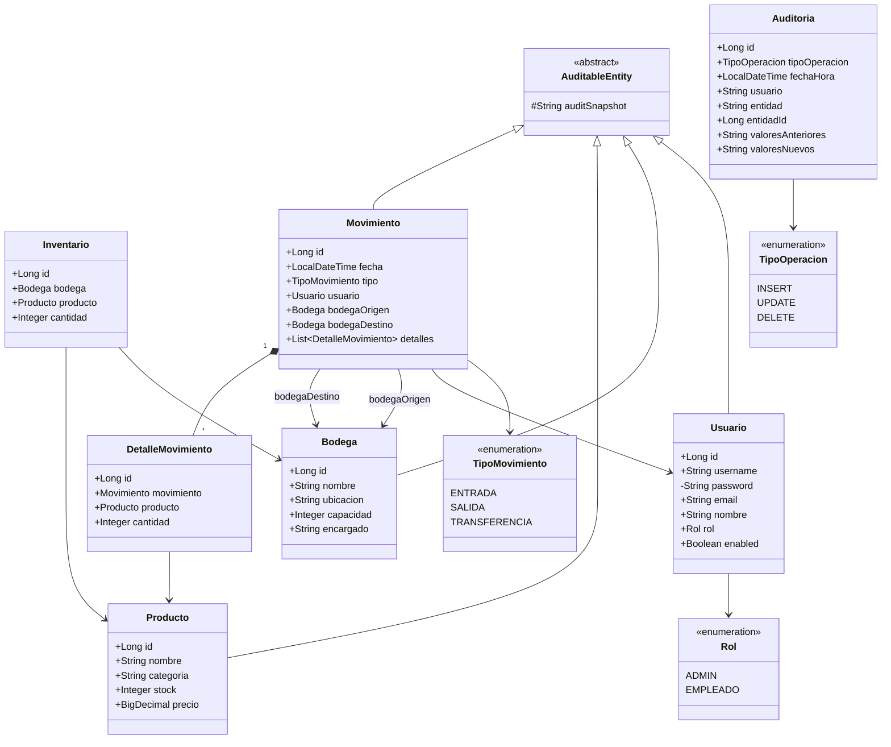

# Arquitectura — LogiTrack S.A.

## Descripción General

LogiTrack es una aplicación backend REST construida con Spring Boot 4.1 que sigue el patrón de arquitectura en capas:

```
┌─────────────────────────────────────────────────────┐
│                  Cliente (Frontend / Swagger)          │
└────────────────────────┬────────────────────────────┘
                         │ HTTP + JSON + JWT
┌────────────────────────▼────────────────────────────┐
│                  Capa de Presentación                  │
│         Controllers (REST + @PreAuthorize)            │
│         JwtAuthenticationFilter                        │
└────────────────────────┬────────────────────────────┘
                         │
┌────────────────────────▼────────────────────────────┐
│                   Capa de Servicio                     │
│         AuthService, BodegaService, etc.               │
│         Lógica de negocio y validaciones              │
└────────────────────────┬────────────────────────────┘
                         │
┌────────────────────────▼────────────────────────────┐
│                  Capa de Persistencia                  │
│         Spring Data JPA Repositories                   │
│         Hibernate + JPA EntityListeners (Auditoría)    │
└────────────────────────┬────────────────────────────┘
                         │
                  ┌────────▼────────┐
                  │   H2 / MySQL    │
                  └─────────────────┘
```

## Diagrama de Clases



## Capas de la Aplicación

### 1. Configuración (`config/`)
- **`SecurityConfig`** — Define el `SecurityFilterChain` con DSL lambda (Spring Security 7). Sesión stateless, CSRF deshabilitado, CORS permitido, rutas públicas vs protegidas.
- **`OpenApiConfig`** — Configura Swagger/OpenAPI 3 con esquema de seguridad Bearer JWT.
- **`AuditConfig`** — ObjectMapper dedicado para serialización de auditoría (independiente del principal).
- **`ApplicationContextHolder`** — Referencia estática al ApplicationContext para que el `AuditEntityListener` (no gestionado por Spring) pueda acceder a los beans.
- **`DataInitializer`** — `CommandLineRunner` que puebla la BD con datos de prueba si está vacía.

### 2. Seguridad (`security/`)
- **`JwtTokenProvider`** — Genera y valida tokens JWT firmados con HMAC-SHA512 usando jjwt 0.12.
- **`JwtAuthenticationFilter`** — Extrae el token del header `Authorization: Bearer`, lo valida y establece la autenticación en el `SecurityContext`.
- **`CustomUserDetailsService`** — Carga usuarios desde la BD para la autenticación.
- **`JwtAuthenticationEntryPoint`** — Devuelve JSON 401 cuando una petición sin token llega a un endpoint protegido.

### 3. Controladores (`controller/`)
- Expone endpoints REST con `@RestController`.
- `@PreAuthorize("hasRole('ADMIN')")` en operaciones de escritura de Bodega, Producto y en toda la auditoría.
- Anotaciones de Swagger (`@Tag`, `@Operation`) para documentación automática.

### 4. Servicios (`service/`)
- Lógica de negocio y orquestación entre repositorios.
- `MovimientoService` — Valida bodegas según tipo, actualiza stock global (Producto) y por bodega (Inventario).
- `AuditoriaService` — Persiste auditorías con `@Transactional(REQUIRES_NEW)` (se llama tras el commit).

### 5. Repositorios (`repository/`)
- Interfaces Spring Data JPA con métodos derivados y `@Query` personalizados.

### 6. Modelo (`model/`)
- **Entidades** JPA con `@EntityListeners(AuditEntityListener.class)`.
- **Enums** para roles, tipos de movimiento y tipos de operación.
- **DTOs** separados en `auth/`, `request/` y `response/` para desacoplar la API de las entidades.

### 7. Auditoría (`listener/`)
- **`AuditEntityListener`** — Captura operaciones INSERT/UPDATE/DELETE con `@PostPersist`, `@PostUpdate`, `@PostRemove`. Usa `@PostLoad` para guardar un snapshot del estado anterior.
- **`AuditHolder`** — `ThreadLocal` que acumula eventos durante la transacción.
- **`AuditSynchronization`** — Se ejecuta tras el commit; persiste los registros en una transacción nueva.

### 8. Excepciones (`exception/`)
- **`GlobalExceptionHandler`** — `@RestControllerAdvice` que convierte excepciones en respuestas JSON estructuradas (400, 401, 403, 404, 500).
- **`BusinessException`** — Reglas de negocio (stock insuficiente, username duplicado).
- **`ResourceNotFoundException`** — Recurso no encontrado (404).

## Flujo de Autenticación JWT

```
Cliente                    AuthController              AuthService            JwtTokenProvider
  │                            │                          │                       │
  │  POST /auth/login          │                          │                       │
  │  {username, password}      │                          │                       │
  │───────────────────────────►│                          │                       │
  │                            │  login(LoginRequest)     │                       │
  │                            │─────────────────────────►│                       │
  │                            │                          │  authenticate()       │
  │                            │                          │  (AuthenticationManager)│
  │                            │                          │                       │
  │                            │                          │  generateToken()      │
  │                            │                          │──────────────────────►│
  │                            │                          │  ◄───────────────────│
  │                            │                          │       JWT string      │
  │                            │  JwtResponse              │                       │
  │  ◄────────────────────────│  {token, type, username, │                       │
  │       200 OK + JWT         │   rol, expiresIn}        │                       │
  │                            │                          │                       │
  │  GET /bodegas              │                          │                       │
  │  Authorization: Bearer JWT │                          │                       │
  │───────────────────────────►│  JwtAuthenticationFilter │                       │
  │                            │  valida token ──────────►│  validateToken()      │
  │                            │                          │  ◄───────────────────│
  │                            │  SecurityContext.setAuth()│       true/false       │
  │                            │  BodegaController        │                       │
  │  ◄────────────────────────│  200 OK + JSON            │                       │
```

### Ejemplo de token JWT decodificado

**Header:**
```json
{
  "alg": "HS512",
  "typ": "JWT"
}
```

**Payload:**
```json
{
  "sub": "admin",
  "role": "ADMIN",
  "iat": 1794586781,
  "exp": 1794673181
}
```

- `sub` — nombre de usuario
- `role` — rol del usuario (ADMIN o EMPLEADO)
- `iat` — timestamp de emisión
- `exp` — timestamp de expiración (24 horas por defecto)
- Firma: HMAC-SHA512 con la clave secreta configurada en `jwt.secret`

## Flujo de Auditoría

```
1. Service guarda entidad (movimientoRepository.save(mov))
       │
       ▼
2. Hibernate ejecuta INSERT/UPDATE/DELETE
       │
       ▼
3. @PostPersist / @PostUpdate / @PostRemove
   AuditEntityListener captura:
   - Tipo de operación (INSERT/UPDATE/DELETE)
   - Usuario actual (SecurityContext)
   - Valores anteriores (snapshot de @PostLoad)
   - Valores nuevos (serialización JSON)
       │
       ▼
4. AuditHolder.add(AuditInfo)  ← ThreadLocal
   AuditSynchronization se registra (una vez por transacción)
       │
       ▼
5. Transacción principal hace COMMIT
       │
       ▼
6. AuditSynchronization.afterCommit()
   → AuditoriaService.registrar() (@Transactional REQUIRES_NEW)
   → INSERT en tabla auditoria (nueva transacción)
```

> La auditoría solo se persiste si la transacción principal se completa con éxito. Si hay rollback, los eventos se descartan.
